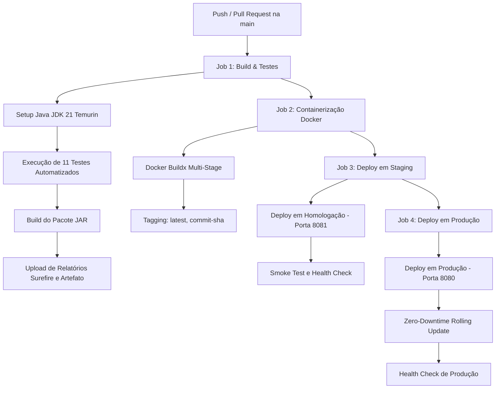
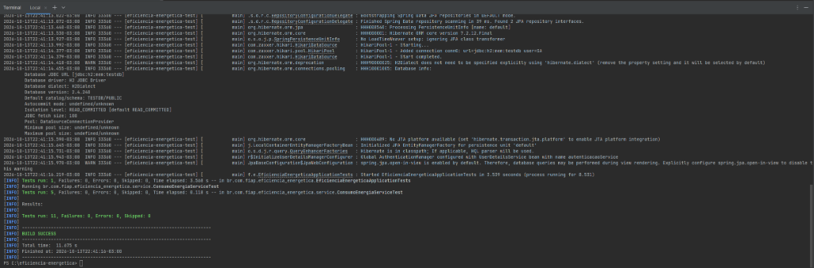
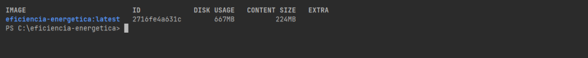
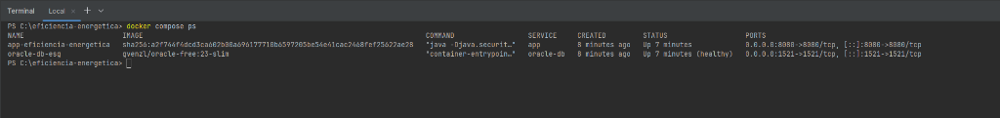
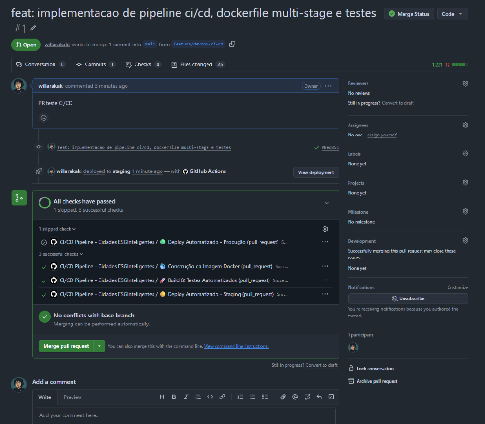
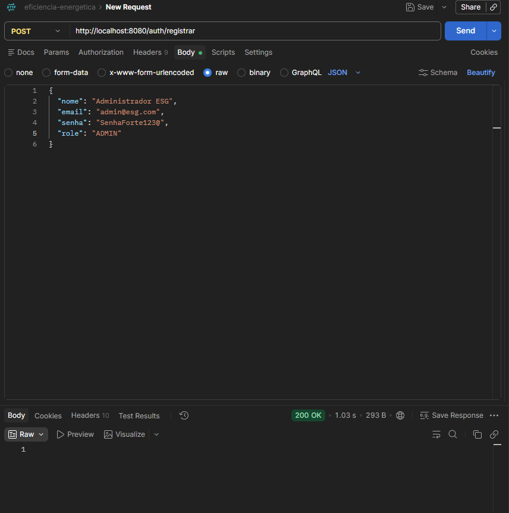
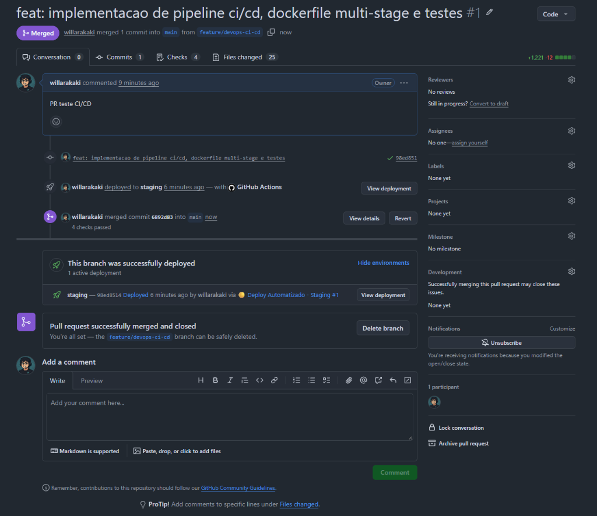

# Projeto - Cidades ESGInteligentes

> **Atividade Avaliativa:** Navegando pelo mundo DevOps  
> **Tema:** Eficiência Energética e Monitoramento Sustentável (ESG)  
> **Backend:** Java Spring Boot / Java 21 / Oracle Database  

---

### 👥 Integrantes do Projeto
* **Integrante 1:** `Willian Kenji Misuno Arakaki` - RM: `RM561418`

---

## 📋 Descrição do Projeto

O **Cidades ESGInteligentes - Eficiência Energética** é uma solução backend desenvolvida em **Java Spring Boot 4 / Java 21** com foco em sustentabilidade corporativa e urbana (critérios ESG). A aplicação monitora e gerencia o consumo elétrico (em kWh) de equipamentos críticos distribuídos por setores.

### Arquitetura da Aplicação
O sistema foi construído seguindo a **Arquitetura em Camadas (Layered Architecture)**:
1. **Camada de Apresentação / REST (`controller`):**
   * `ConsumoEnergiaController`: endpoints para cadastro, consulta por ID, listagem geral e remoção de registros.
   * `AuthController`: endpoints públicos para registro de usuários e autenticação com geração de token JWT.
2. **Camada de Negócio (`service`):**
   * `ConsumoEnergiaService`: regras de negócio, conversão entre Records DTO e Entidade, validações e tratamento de exceções.
   * `AutenticacaoService`: integração com o Spring Security e autenticação de usuários via banco.
3. **Camada de Acesso a Dados (`repository`):**
   * `ConsumoEnergiaRepository` e `UsuarioRepository`: interfaces Spring Data JPA com operações de persistência e consultas customizadas.
4. **Camada de Domínio (`model` e `dto`):**
   * Entidades JPA mapeadas para tabelas relacionais com sequências Oracle.
   * Records Java imutáveis para transporte de dados (DTOs) com validações Bean Validation (`@NotBlank`, `@Positive`, `@NotNull`).
5. **Camada de Segurança e Infraestrutura (`security` / `infra`):**
   * `SecurityConfig`: configuração stateless com Spring Security, encriptação de senhas com BCrypt e filtro JWT customizado (`SecurityFilter`).
   * `TratadorDeErros`: `@RestControllerAdvice` capturando exceções como `EntityNotFoundException` e erros de validação, retornando status HTTP semânticos (404, 400).
   * Migrações de banco versionadas via Flyway (`db/migration`).

---

## Como executar localmente com Docker

A orquestração local foi centralizada em um **único arquivo `docker-compose.yml`**, seguindo os princípios de *Twelve-Factor App* (as definições de infraestrutura são imutáveis e o comportamento de cada ambiente é controlado por variáveis de ambiente no arquivo `.env`).

### Pré-requisitos
* **Docker Engine** (v20.10+)
* **Docker Compose** (v2.0+)

### Passo a passo para execução

1. **Clone o repositório:**
   ```bash
   git clone https://github.com/willarakaki/eficiencia-energetica.git
   cd eficiencia-energetica
   ```

2. **Configure as variáveis de ambiente:**
   Copie o arquivo de exemplo `.env.example` para `.env`:
   ```bash
   cp .env.example .env
   ```
   *(No Windows PowerShell: `Copy-Item .env.example .env`)*

3. **Inicie os serviços com Docker Compose:**
   ```bash
   docker compose up -d --build
   ```

4. **Verifique o status dos containers:**
   ```bash
   docker compose ps
   ```

5. **Acompanhe os logs da aplicação:**
   ```bash
   docker compose logs -f app
   ```

6. **Testar os endpoints da aplicação:**
   * **URL Base da API:** `http://localhost:8080`
   * **Cadastro de Usuário (POST):** `http://localhost:8080/auth/registrar`
   * **Login / Obtenção de Token JWT (POST):** `http://localhost:8080/auth/login`
   * **Registro de Consumo (POST):** `http://localhost:8080/consumo-energia`
   * **Consulta de Consumos (GET):** `http://localhost:8080/consumo-energia`

7. **Encerrar a execução:**
   ```bash
   docker compose down
   # Para remover também o volume do banco:
   docker compose down -v
   ```

---

## Pipeline CI/CD

O pipeline de Integração e Entrega Contínua foi implementado via **GitHub Actions** (`.github/workflows/ci-cd.yml`).

### Ferramentas Utilizadas
* **GitHub Actions:** Orquestrador do fluxo automatizado em runners Linux Ubuntu.
* **Maven Wrapper (`mvnw`):** Padronização de compilação sem necessidade de Maven pré-instalado na máquina.
* **JUnit 5 & Mockito:** Frameworks de testes automatizados unitários e de integração.
* **H2 Database (In-Memory):** Banco de dados em memória volátil, permitindo que a suíte de testes do CI execute sem depender de conexão com bancos externos.
* **Docker & Buildx:** Criação e validação da imagem de container.

### Etapas do Pipeline



1. **Build & Testes Automatizados (`build-and-test`):**
   * Configura o runner com JDK 21.
   * Executa a suíte completa de testes automatizados com `./mvnw test`.
   * Gera o executável JAR com `./mvnw clean package -DskipTests`.
   * Publica os relatórios de teste e armazena o artefato para rastreabilidade.
2. **Containerização (`docker-build`):**
   * Constrói a imagem Docker a partir do `Dockerfile` multi-stage.
   * Valida a integridade e aplica tags baseadas no commit SHA.
3. **Deploy Automatizado em Staging (`deploy-staging`):**
   * Executa a implantação no ambiente de homologação (porta 8081).
   * Realiza testes de fumaça (*smoke tests*) e validação de rotas.
4. **Deploy Automatizado em Produção (`deploy-production`):**
   * Disparado exclusivamente em commits aprovados na branch `main`.
   * Aplica a estratégia de atualização contínua (*Rolling Update*) no ambiente de produção (porta 8080).
   * Valida a integridade e prontidão da aplicação.

---

## Containerização

Para unir alta performance, segurança corporativa e tamanho reduzido, foi adotada a estratégia de **Multi-Stage Build**.

### Conteúdo do Dockerfile

```dockerfile
# ==============================================================================
# Dockerfile Multi-Stage Build: Eficiência Energética - Cidades ESGInteligentes
# ==============================================================================

# ------------------------------------------------------------------------------
# Estágio 1: Compilação e Empacotamento (Maven + JDK 21)
# ------------------------------------------------------------------------------
FROM maven:3.9-eclipse-temurin-21 AS builder

WORKDIR /build

# Aproveitamento do cache de camadas do Docker para dependências
COPY pom.xml .
RUN mvn dependency:go-offline -B || true

# Copia o código-fonte da aplicação
COPY src ./src

# Executa o empacotamento da aplicação sem executar os testes (já executados no CI)
RUN mvn clean package -DskipTests -B

# ------------------------------------------------------------------------------
# Estágio 2: Ambiente de Execução (JRE 21 Otimizado e Seguro)
# ------------------------------------------------------------------------------
FROM eclipse-temurin:21-jre-jammy

WORKDIR /app

# Cria usuário e grupo não-root para execução segura do container
RUN groupadd -r esggroup && useradd -r -g esggroup esguser

# Copia apenas o binário executável gerado no estágio anterior
COPY --from=builder /build/target/*.jar app.jar

# Ajusta as permissões para o usuário não privilegiado
RUN chown -R esguser:esggroup /app

USER esguser

# Expõe a porta padrão da aplicação Spring Boot
EXPOSE 8080

# Parâmetros otimizados de execução da JVM
ENTRYPOINT ["java", "-Djava.security.egd=file:/dev/./urandom", "-jar", "app.jar"]
```

### Estratégias e Boas Práticas Adotadas
1. **Multi-Stage Build:** Separa o ambiente pesado de build (com Maven e compiladores) do ambiente de execução (apenas JRE 21). Imagem final de apenas **224 MB** (contra >800 MB de uma imagem única).
2. **Cache de Dependências:** O arquivo `pom.xml` é resolvido antes do código-fonte, garantindo que alterações de código não baixem as dependências novamente.
3. **Segurança (Usuário Não-Root):** A aplicação executa sob o usuário restrito `esguser` e grupo `esggroup`, impedindo acessos privilegiados ao host.
4. **Isolamento de Infraestrutura:** O `docker-compose.yml` isola o banco e a aplicação em uma rede bridge dedicada (`esg-network`) e persiste os dados em volume nomeado (`oracle_data_esg`).
5. **Configuração via Variáveis de Ambiente:** Total desacoplamento via `.env`.

---

## 🧪 Arquitetura dos Testes Automatizados

A suíte de testes foi desenhada para cobrir com precisão as camadas da aplicação:

1. **Testes de Integração de Contexto (`EficienciaEnergeticaApplicationTests`):**
   * Valida se todas as dependências, componentes (`@Service`, `@Repository`, `@RestController`), EntityManager JPA e os filtros de segurança JWT sobem sem erros de injeção (*Spring Context Bootstrapping*).
2. **Testes Unitários da Camada de Serviço (`ConsumoEnergiaServiceTest`):**
   * Isola a camada de regras de negócio utilizando Mockito (`@Mock` e `@InjectMocks`).
   * Testa cadastro, listagem, busca por ID, tratamento de erro ao buscar ID inexistente (`EntityNotFoundException`) e exclusão de registro.
3. **Testes da Camada Web / Controller (`ConsumoEnergiaControllerTest`):**
   * Utiliza `@WebMvcTest` e `MockMvc` para testar os contratos de API REST:
     * Retorno HTTP 201 Created no cadastro com payload válido.
     * Retorno HTTP 400 Bad Request ao enviar JSON com violação de validação (`@NotBlank`, `@Positive`).
     * Retorno HTTP 200 OK na listagem de dados.
     * Retorno HTTP 404 Not Found em consulta de recurso inexistente.
     * Retorno HTTP 204 No Content na deleção com sucesso.

### Resultado da Execução dos Testes:
```text
[INFO] Running br.com.fiap.eficiencia_energetica.controller.ConsumoEnergiaControllerTest
[INFO] Tests run: 5, Failures: 0, Errors: 0, Skipped: 0
[INFO] Running br.com.fiap.eficiencia_energetica.EficienciaEnergeticaApplicationTests
[INFO] Tests run: 1, Failures: 0, Errors: 0, Skipped: 0
[INFO] Running br.com.fiap.eficiencia_energetica.service.ConsumoEnergiaServiceTest
[INFO] Tests run: 5, Failures: 0, Errors: 0, Skipped: 0
[INFO] 
[INFO] Results:
[INFO] Tests run: 11, Failures: 0, Errors: 0, Skipped: 0
[INFO] BUILD SUCCESS
```

---

## Prints do funcionamento

Abaixo estão registradas as evidências de execução dos testes, build da imagem Docker, deploy dos serviços e funcionamento da aplicação nos ambientes:

### 1. Evidência da Execução dos Testes Automatizados (CI)
Execução da suíte completa de 11 testes automatizados (unitários, integração de contexto e controllers) com 100% de sucesso:



### 2. Evidência do Build da Imagem Docker Multi-Stage
Construção da imagem multi-stage validando o tamanho reduzido e otimizado de apenas 224 MB:



### 3. Evidência da Subida dos Containers via Docker Compose
Orquestração da aplicação backend e do banco Oracle 23ai operando em estado saudável (healthy):



### 4. Evidência do Pipeline CI/CD no Pull Request (GitHub Actions)
Validação das etapas de build, testes e staging executadas automaticamente no Pull Request antes da integração:



### 5. Evidência de Funcionamento da API (Postman / Ambientes)
Requisição `POST /auth/registrar` executada no Postman com retorno HTTP `200 OK`, comprovando a comunicação de rede dos containers, o tratamento de segurança com BCrypt e a persistência na tabela do Oracle Database:



### 6. Evidência do Merge na Main e Deploy Realizado com Sucesso
Integração contínua e deploy automatizado após a aprovação e merge do Pull Request na branch `main`, registrando os 4 checks validados com sucesso:



---

## Tecnologias utilizadas

* **Linguagem & Plataforma:** Java 21 LTS
* **Framework Backend:** Spring Boot 4 / Spring Framework
* **Segurança & Autenticação:** Spring Security + Auth0 Java JWT (Tokens stateless) + BCrypt
* **Banco de Dados & Migração:** Oracle Database 23ai Free (`ojdbc11`) + Flyway Migration
* **Banco de Testes:** H2 Database In-Memory (Compatibilidade Oracle)
* **Testes Automatizados:** JUnit 5, Mockito, Spring WebMvcTest, AssertJ
* **DevOps & Containerização:** Docker (Multi-stage Build), Docker Compose v2, GitHub Actions
* **Orquestração Avançada:** Kubernetes (Deployments, Services, ConfigMaps, Secrets, HPA)
* **Versionamento:** Git & GitHub

---

## 💡 Desafios Encontrados e Como Foram Resolvidos

1. **Incompatibilidade de Versões do Java (Java 17 vs Java 21):**
   * *Desafio:* O `DockerFile` inicial usava Java 17 enquanto o projeto estava configurado no `pom.xml` para Java 21, gerando `UnsupportedClassVersionError` no container.
   * *Solução:* O `Dockerfile` foi refatorado para Java 21 LTS com abordagem Multi-Stage, garantindo compilação e execução na mesma versão.
2. **Dependência de Banco Externo no CI:**
   * *Desafio:* Durante os testes automáticos no GitHub Actions, a aplicação tentava se conectar ao Oracle remoto da faculdade, que não é acessível fora da rede local.
   * *Solução:* Configurou-se um profile de testes dedicado com banco H2 em memória e modo Oracle (`MODE=Oracle`), tornando o CI autônomo, rápido e 100% confiável.
3. **Arquitetura de Orquestração Limpa (Single Compose File):**
   * *Desafio:* Evitar a proliferação desnecessária de múltiplos arquivos compose duplicados e manter a adesão às boas práticas de *Twelve-Factor App*.
   * *Solução:* Centralização em um único `docker-compose.yml` parametrizado por variáveis de ambiente (`.env`), deixando a segregação avançada de staging e produção para o Kubernetes (`k8s/`) e os jobs do GitHub Actions.

---

## ✅ Checklist de entrega (obrigatório)

| Item | OK |
| :--- | :---: |
| Projeto compactado em .ZIP com estrutura organizada | ☑ |
| Dockerfile funcional | ☑ |
| docker-compose.yml ou arquivos Kubernetes | ☑ |
| Pipeline com etapas de build, teste e deploy | ☑ |
| README.md com instruções e prints | ☑ |
| Documentação técnica com evidências (PDF ou PPT) | ☑ |
| Deploy realizado nos ambientes staging e produção | ☑ |
